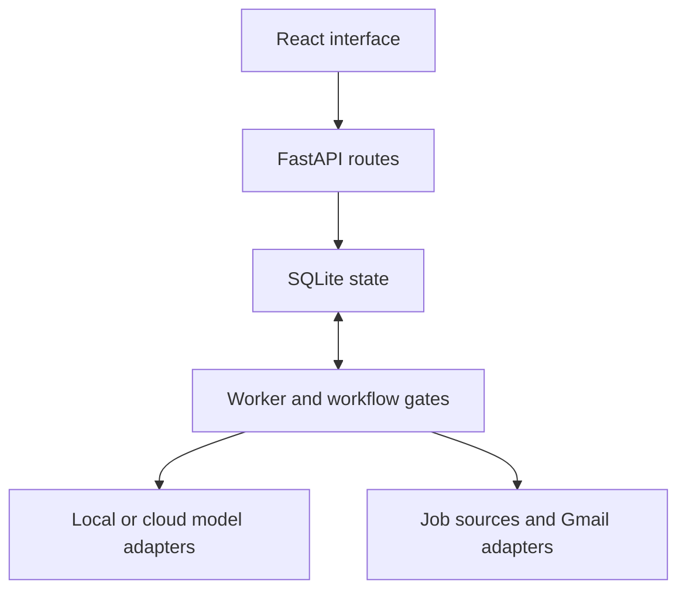

# Architecture

Agent HQ combines a FastAPI backend, SQLite state, a worker/supervisor process, and a React/Vite frontend.
The main boundaries are visible in the source layout:

| Directory | Responsibility |
|---|---|
| `hq/api/` | Authenticated API routes and frontend delivery |
| `hq/db/` | Persistence, migrations and seed data |
| `hq/worker/` | Task orchestration, budgets and effects |
| `hq/models/`, `hq/llm/` | Model discovery, role assignment and provider routing |
| `hq/pipeline/` | Opportunity checks and application workflow |
| `hq/gmail/` | Gmail authorization, inbox and sending adapters |
| `web/src/` | React interface, pages and state |
| `agents/`, `config/` | Agent definitions, facts, rules and source configuration |
| `tests/` | Isolated test fixtures and unit/integration scenarios |

The application is a local deployment with optional external integrations. OAuth setup and go-live
controls remain part of the existing application. Consult the README for runtime paths and operational
steps; these documentation changes do not alter those controls.
